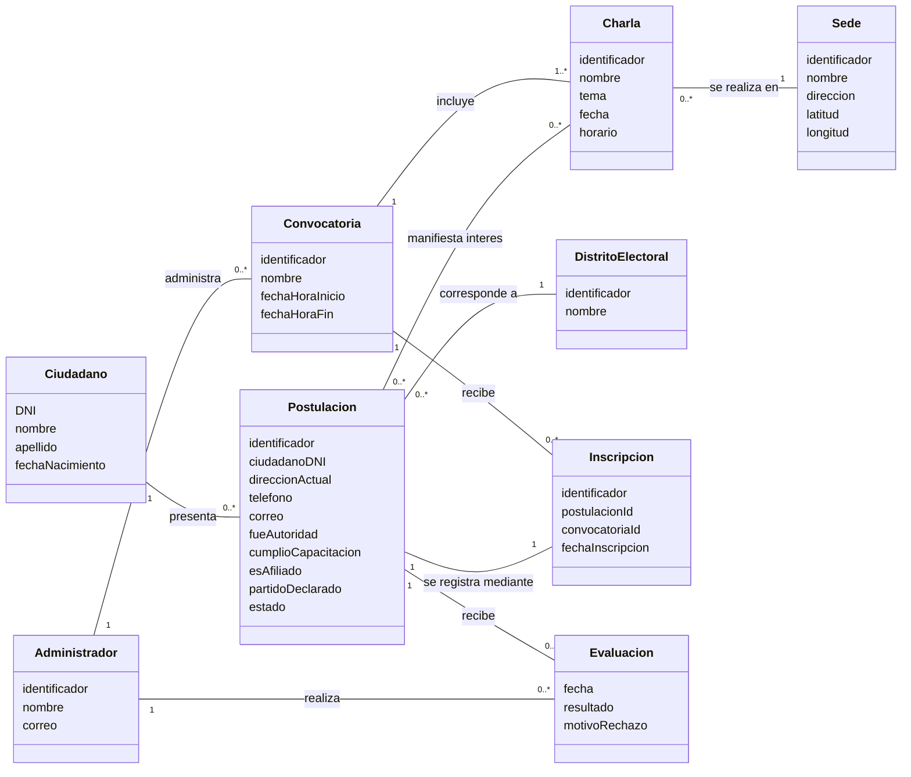

# Propuesta de modelo conceptual

Borrador de apoyo para revisar e incorporar al PDF del TP. Representa el dominio del enunciado completo; la web implementa solamente inscripción, charlas y ubicación. Los servicios de correo y mapas son actores externos, no entidades del dominio.

## Lectura de entidades y relaciones

- **Convocatoria:** delimita el período de inscripción y reúne sus charlas e inscripciones. Se supone un administrador responsable por convocatoria.
- **Charla:** actividad de orientación con nombre, tema, fecha y horario; pertenece a una convocatoria y ocurre en una sede. Una sede puede albergar varias charlas.
- **Sede:** nombre y dirección del lugar. Las coordenadas permiten ubicarla mediante el servicio externo.
- **Ciudadano:** identidad de la persona. Puede presentar distintas postulaciones.
- **Postulación:** solicitud de un ciudadano con sus datos de contacto, antecedentes, distrito, intereses y estado de revisión. Cada postulación concreta se registra en un período mediante una inscripción.
- **Inscripción:** entidad intermedia que vincula exactamente una postulación con exactamente una convocatoria y conserva la fecha de inscripción. La combinación de ciudadano y convocatoria no puede repetirse; el mismo DNI puede postularse de nuevo en otra convocatoria.
- **Distrito electoral:** referencia seleccionada obligatoriamente al postularse. No se infiere a partir de la sede de una charla.
- **Interés en charla:** relación opcional de muchos a muchos. Solo pueden elegirse charlas de la misma convocatoria. No representa reserva, inscripción a la charla ni asistencia.
- **Evaluación:** resultado administrativo posterior al cierre. Una postulación puede no estar evaluada o tener una evaluación. El motivo es obligatorio si se rechaza.
- **Administrador:** responsable de las convocatorias y de la evaluación. Las operaciones administrativas no están implementadas en esta web.

## Restricciones

1. La fecha de inicio coincide con la primera charla y la fecha de fin con la última. Para el prototipo se incluyen ambos días completos en UTC−03:00.
2. No se admiten postulaciones fuera de plazo.
3. Cada postulación tiene una sola inscripción y cada inscripción corresponde a una sola postulación y convocatoria. La unicidad se aplica a la combinación de DNI del ciudadano y convocatoria, no al DNI globalmente.
4. El partido declarado es obligatorio cuando existe afiliación; de otro modo queda vacío.
5. No se exige experiencia, capacitación ni interés en charlas para registrar una postulación.
6. La evaluación se realiza después del cierre; aprobar o rechazar produce una notificación en el sistema completo.
7. El reporte final deriva de las postulaciones aprobadas; los reportes se consideran resultados de consulta y no entidades persistentes en este modelo mínimo.

## Correspondencia con el código

En la implementación, `datos.js` representa convocatorias de ejemplo para 2026, 2027 y 2028, además de distritos, sedes y charlas. La demo tiene tres inscripciones de ejemplo por período, con una entidad Ciudadano reutilizable y postulaciones e inscripciones distintas para cada convocatoria. La demo permite seleccionar el período y filtra las inscripciones por convocatoria; los escenarios de reloj se calculan con las fechas del período seleccionado. El repositorio persiste por separado `ciudadanos`, `postulaciones` e `inscripciones`: cada inscripción contiene `postulacionId` y `convocatoriaId`, mientras la postulación referencia al ciudadano mediante su DNI. La unicidad se controla por DNI del ciudadano + convocatoria, de modo que puede presentar una postulación en cada período sin duplicarla dentro del mismo. La interfaz proyecta las tres entidades para conservar el flujo existente de revisión y comprobante. Al cargar datos locales anteriores, el repositorio migra la colección plana de `solicitudes` o `inscripciones` al modelo separado. Los intereses se guardan como identificadores de charlas. Evaluación y administrador quedan únicamente en el modelo del sistema completo.

Revisar con el grupo las decisiones de cardinalidad, la regla de unicidad por DNI y convocatoria y el tratamiento de reportes antes de dar por definitivo el diagrama de dominio.
