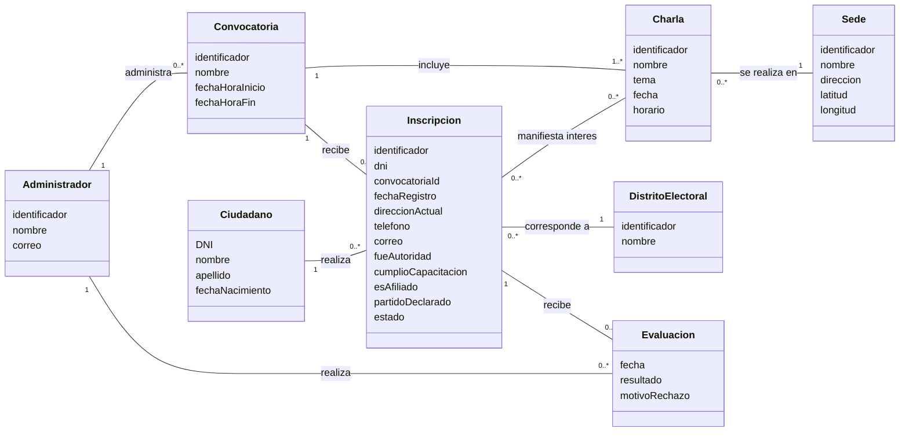

# Propuesta de modelo conceptual

Borrador de apoyo para revisar e incorporar al PDF del TP. Representa el dominio del enunciado completo; la web implementa solamente inscripción, charlas y ubicación. Los servicios de correo y mapas son actores externos, no entidades del dominio.

## Lectura de entidades y relaciones

- **Convocatoria:** delimita el período de inscripción y reúne sus charlas y postulaciones. Se supone un administrador responsable por convocatoria.
- **Charla:** actividad de orientación con nombre, tema, fecha y horario; pertenece a una convocatoria y ocurre en una sede. Una sede puede albergar varias charlas.
- **Sede:** nombre y dirección del lugar. Las coordenadas permiten ubicarla mediante el servicio externo.
- **Ciudadano:** identidad de la persona. Puede postularse a distintas convocatorias.
- **Inscripción:** entidad asociativa que vincula un ciudadano con una convocatoria y representa su postulación para ese período. Conserva los datos de contacto y antecedentes declarados, el distrito y el estado de revisión. Cada combinación de ciudadano y convocatoria admite una sola inscripción; el mismo DNI puede inscribirse de nuevo en otra convocatoria.
- **Distrito electoral:** referencia seleccionada obligatoriamente al postularse. No se infiere a partir de la sede de una charla.
- **Interés en charla:** relación opcional de muchos a muchos. Solo pueden elegirse charlas de la misma convocatoria. No representa reserva, inscripción a la charla ni asistencia.
- **Evaluación:** resultado administrativo posterior al cierre. Una postulación puede no estar evaluada o tener una evaluación. El motivo es obligatorio si se rechaza.
- **Administrador:** responsable de las convocatorias y de la evaluación. Las operaciones administrativas no están implementadas en esta web.

## Restricciones

1. La fecha de inicio coincide con la primera charla y la fecha de fin con la última. Para el prototipo se incluyen ambos días completos en UTC−03:00.
2. No se admiten postulaciones fuera de plazo.
3. La unicidad se aplica a la combinación de DNI y convocatoria, no al DNI globalmente.
4. El partido declarado es obligatorio cuando existe afiliación; de otro modo queda vacío.
5. No se exige experiencia, capacitación ni interés en charlas para registrar una postulación.
6. La evaluación se realiza después del cierre; aprobar o rechazar produce una notificación en el sistema completo.
7. El reporte final deriva de las inscripciones aprobadas; los reportes se consideran resultados de consulta y no entidades persistentes en este modelo mínimo.

## Correspondencia con el código

En la implementación, `datos.js` representa convocatorias de ejemplo para 2026, 2027 y 2028, además de distritos, sedes y charlas. La demo permite seleccionar el período y filtra las inscripciones por `convocatoriaId`; los escenarios de reloj se calculan con las fechas del período seleccionado. El repositorio persiste una colección de `inscripciones`; cada registro refiere a una convocatoria mediante `convocatoriaId` y al ciudadano mediante `dni`, además de conservar los datos declarados como fotografía de esa postulación. La unicidad se controla por `dni` + `convocatoriaId`, de modo que una persona puede volver a inscribirse en otro período. Al cargar datos locales anteriores, el repositorio migra la colección `solicitudes` a `inscripciones`. Los intereses se guardan como identificadores de charlas. Evaluación y administrador quedan únicamente en el modelo del sistema completo.

Revisar con el grupo las decisiones de cardinalidad, la regla de unicidad por DNI y convocatoria y el tratamiento de reportes antes de dar por definitivo el diagrama de dominio.
